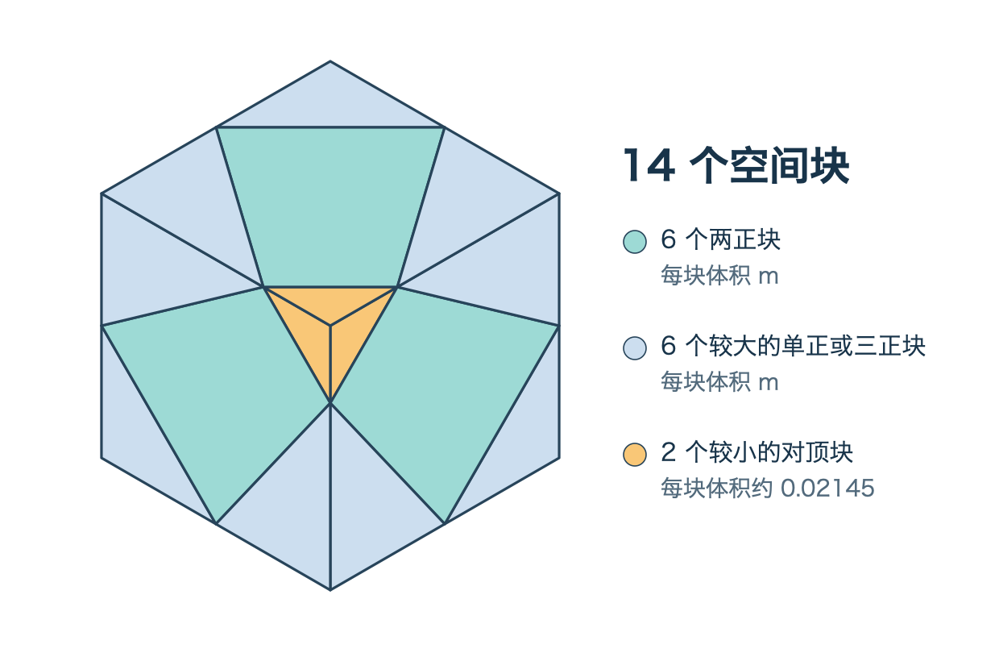

# 四个平面切立方体

用四个任意仿射平面切一个单位立方体，最大一块的体积最小能是多少？本仓库给出构造、全局下界和等号条件的计算机辅助证明。

$$
\min M=\frac{1+2\sqrt2}{48}=0.0797588984322122937\ldots
$$

取立方体为 $[-1/2,1/2]^3$。四个平面为 $x+y+z=0$、$\sqrt2 x-y-z=0$ 及后者的两个坐标轮换。这一切法得到 14 块，12 块达到上式，另两块各为 $(3-2\sqrt2)/8$。立方体对称和刀号重排给出所有等号情形。

从上界的手算开始，可读[图解证明](publication/zhihu-proof.md)。细读分类与唯一性，可读[知乎长文版](publication/zhihu-answer.md)。核对完整论证，可从[主定理的三步证明](proof/README.md#global-equality)逐项进入。

本轮复算共 2,005 项。运行进度、逐项记录的说明和复核结果见[验证报告](evidence/README.md)。

## 复现

本次验证使用 ARM64 macOS、Python 3.9.6 和 Apple Clang 21。复算需要 Python 3.9 或更高版本，以及支持 C++20、128 位整数和 UBSan 的编译器。运行器使用 POSIX 文件锁，Linux 或 WSL 也可按下列命令尝试复算。Python 计算仅使用标准库。以下命令从仓库根目录运行。证书使用 Python 断言，请保留默认执行模式。

**先核对等号和分类。** 第一条用 $\mathbb Q(\sqrt2)$ 核对候选体积和一阶导数。第二条枚举顶点类型并核对每个代表、角星最大列轨道和分区记录。第三条用 Burnside 引理独立复算初始的 3,746 个轨道。

~~~sh
python3 -EB proof/local_certificate.py
python3 -B proof/check_classification_records.py
python3 -B checks/vertex_orbits.py
~~~

**从源码完整重算。** 选择一个尚未存在的输出目录。可把 4 改成本机适宜的进程数，也可以用环境变量 `CXX` 指定编译器。所有 C++ 证书启用断言及未定义行为检测。完整运行需要数小时，机器与并行度会影响耗时。

~~~sh
python3 -B proof/verify_global_proof.py --jobs 4 replay
python3 -B proof/check_classification_records.py --replay replay
~~~

最后一条命令成功退出时会输出 `2005 replay jobs passed and all log digests match.`，随后列出与历史覆盖树的统计差异。节点数可能随搜索权重改变；审核器逐项核对任务、日志摘要和终止条件。

如果中途关机或终止进程，保留原目录，运行 `python3 -B proof/verify_global_proof.py --resume --jobs 4 replay`。续跑会核对输入快照、编译器、任务清单及先前成功项的日志摘要，从每个未完成任务的根盒重新计算。

运行器保存源码快照、编译选项、分类清单、每项命令与标准输入、退出码和原始输出。独立核对程序重新生成顶点代表、128 个体积门槛和任务清单，检查每项输出的 SHA-256、终止条件和历史树统计。新的覆盖树可以使用不同的有效权重；每个参数域均须闭合。主证明对每个域选择一条充分的证书路径。研究笔记还给出较早的下界和部分域的第二种算法。

**审阅已有运行或交叉检查几何实现。** 发布附带的运行资料与读者自己的重算目录使用同一核对入口。源代码比较需要 Clang 的词法分析器。最后一条用精确有理数多面体裁切交叉检查两个体积积分器和方向插值误差界，也检查整数输入的精确返回值。

~~~sh
python3 -B proof/check_classification_records.py --replay evidence/run
python3 -B checks/source_equivalence.py evidence/run/sources
python3 -B checks/rational_checks.py
~~~

## 证明代码从哪里读

| 要核对的问题 | 证明和实现 |
| --- | --- |
| 三刀只切出七块时，为什么可以提前排除？ | [归约与两个参数域](proof/affine-gram-bm-proof.md#why-two-charts-cover-the-seven-cell-case) · [两个连续域的覆盖](proof/seven_scaled_charts_certificate.cpp) |
| 全部顶点分法有没有遗漏？ | [组合排除](proof/affine-edge-and-vertex-proof.md) · [对称轨道枚举](proof/vertex_partition_census.py) |
| 非交替类型的整个连续域如何排除？ | [两棱](proof/affine-two-edge-proof.md) · [一棱与无棱](proof/affine-one-and-zero-edge-proof.md) · [通用覆盖器](proof/affine_vertex_type_cover.cpp) · [混合面类型](proof/affine_mixed_face_cover.cpp) |
| 唯一留下的交替类型如何覆盖？ | [六个方向排列](proof/reciprocal-pivot-proof.md) · [含等号的四种排列](proof/affine_alternating_candidate_cover.cpp) |
| 局部最优和等号如何验证？ | [局部论证](proof/local-candidate-proof.md#angular-radius-35) · [整数正定性检验](proof/affine_local_merit_certificate.py) · [所有独立偏移](proof/affine_angular_offset_transfer.cpp) |
| 体积界怎样舍入？ | [整数积分](proof/seven_integer_volume.hpp) · [面投影积分](proof/affine_face_integral.hpp) · [区间误差传播](proof/affine_box_linear.hpp) |
| 本次重算覆盖了哪些域？ | [验证报告](evidence/README.md) |

离散分类、几何归约、投影面积公式和连续性论证写在证明文档中。计算部分用有理算术或向外舍入，少数程序用浮点数建议权重，再以整数验证最终比较。数学论证依赖这些实现、编译器和所引用的几何定理；附带的有理数样例用于检查几何实现的对应关系。

简版图解的三张 SVG 由 `python3 publication/draw_figures.py` 生成。知乎长文的构型图、四种单刀图和六个轨道图由 `python3 publication/draw_answer_figures.py` 生成。两组图的 SVG 和排版用 PNG 都在 `publication/figures/`。

## 作者与许可

ky_reflection（GitHub 账号 [ky-reflection](https://github.com/ky-reflection)），联系邮箱 `kyreflection@gmail.com`。本仓库的验证代码、证明文稿和配图均按 [MIT 许可证](LICENSE) 发布。
