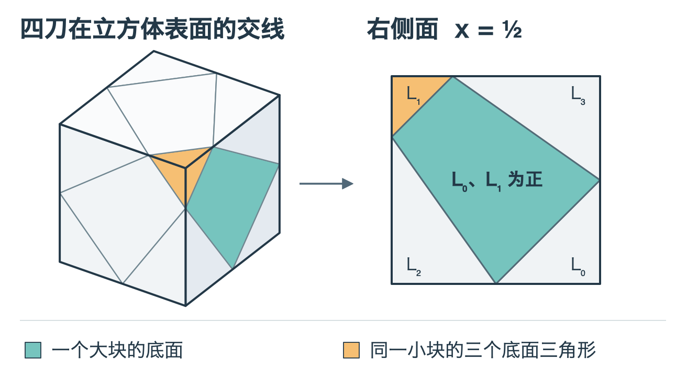
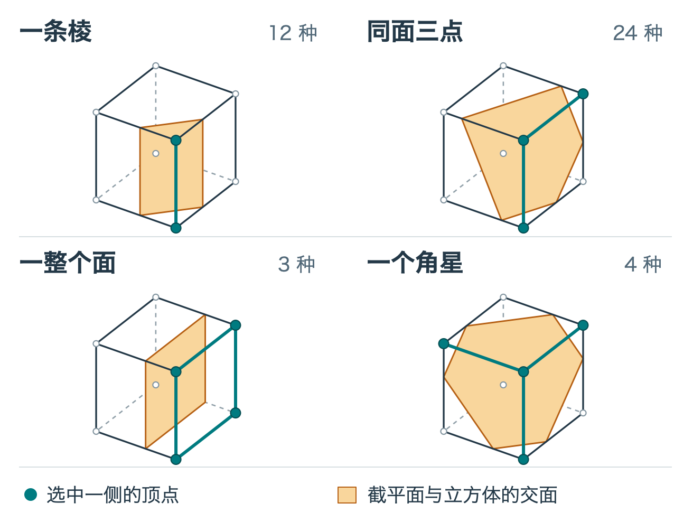

用四个任意平面切割单位立方体（每刀贯穿整个立方体，切开后不移动），最大块体积的最小值为

$$
m = \frac{1+2\sqrt{2}}{48} \approx 0.0797589 .
$$

在立方体的旋转、镜像以及四刀重排意义下，取到该最小值的切法唯一。

四个平面至多可将立方体切成 $15$ 块（前三刀至多 $8$ 块，第四个平面被三条交线至多分为 $7$ 片），理论平均下界为 $1/15 \approx 0.06667$；但最优切法四刀共交于立方体中心，仅切出 **$14$ 块**：其中 $12$ 块体积均为 $m$，另 $2$ 块为对顶小块，体积均为 $\frac{3-2\sqrt{2}}{8} \approx 0.02145$。

将立方体置于 $[-1/2, 1/2]^3$，最优构型由以下四个过中心的平面给出：

$$
\begin{aligned}
L_0 &= x + y + z = 0, & L_1 &= \sqrt{2}\,x - y - z = 0, \\
L_2 &= -x + \sqrt{2}\,y - z = 0, & L_3 &= -x - y + \sqrt{2}\,z = 0 .
\end{aligned}
$$

由于 $(2-\sqrt{2})L_0 + L_1 + L_2 + L_3 = 0$ 且四个系数均严格为正，全正与全负两块均为空。任意三个法向都线性无关（例如后三个法向的行列式为 $(1+\sqrt2)^2(\sqrt2-2)\ne0$，再用上述正系数关系即可换入第一个法向）。四个中心平面逐次切出 $2,4,8,14$ 个区域，且每个区域都伸入中心附近的开立方体。四平面过中心，每块均为以中心为顶点的锥体，体积等于它在立方体表面所占面积的 $1/6$。将后三式中的 $\sqrt{2}$ 换为待定参数 $t \in (1,2)$，由对称性令外围两类共 $12$ 块体积相等，解二次方程即得 $t = \sqrt{2}$。

上界构型本身较为直观，下文展开全局下界与唯一性的完整证明思路：凡可在回答内直接写清的分类完备性、几何归约与拓扑闭合均给出完整论证；需要计算机辅助证明的环节，则推导至真正进入计算验证的精确问题为止。

---

### 一、一般位置与阈值设定

先考察**一般位置**（无平面过立方体顶点、无平行面、无四刀共点），并取略大于 $m$ 的有理阈值

$$
q = 0.079759 < \frac{2}{25} .
$$

设一般位置的四刀切法满足最大块体积 $M \le q$。后续各步将证明：除唯一一类顶点分法外均有 $M > q$；而在唯一剩余类别中，取介于 $m$ 与 $q$ 之间的有理阈值 $q_* = \lceil 2^{40}m \rceil / 2^{40}$（满足 $m < q_* < q$），所有满足 $M \le q_*$ 的切法方向必落入候选构型的一个显式闭邻域（及其对称像），并在该邻域内对任意偏移证得 $M \ge m$ 且等号唯一。退化情形（含四刀共点）在第六节通过连续性收回。

---

### 二、单刀分类的完备性与四刀组合轨道（$43$ 种单刀 $\to 3{,}746$ 类）

#### 1. 排除零顶点侧与单顶点侧

对任意一刀，其一侧至多容纳其余三刀切出的 $8$ 块，总体积不超过 $8q < 0.64$，故另一侧体积满足

$$
V \ge 1 - 8q > \frac{9}{25} > \frac{1}{6} .
$$

在 $[0,1]^3$ 中，若某半空间不含任何立方体顶点，由凸性其体积为 $0$。若某半空间仅含 $1$ 个顶点，平移至原点 $(0,0,0)$ 并记该侧为 $ax + by + cz \le d$；原点在内给出 $d > 0$，三个棱邻点 $(1,0,0),(0,1,0),(0,0,1)$ 在外给出 $a,b,c \ge d$。于是该侧完全包含于角单纯形 $x + y + z \le 1$ 中，体积不超过 $1/6$，矛盾。因此**每刀两侧至少各含 $2$ 个顶点**。

#### 2. 向下封闭性与四种单刀的完备性

对任意一刀，适当翻转三个坐标轴方向，可使其法向分量全部非负，选定侧写为 $ax + by + cz \le d$（$a,b,c \ge 0$）。此时入选的顶点子集在 $\{0,1\}^3$ 的坐标逐项偏序下**向下封闭**（若某顶点入选，将其任一坐标由 $1$ 改为 $0$ 所得顶点必同时入选）。取顶点数不超过 $4$（且至少为 $2$）的一侧，穷举全部向下封闭子集，仅有以下四种：

1. **$2$ 个顶点**：必为 $(0,0,0)$ 与一个权为 $1$ 的邻点，即一条棱的两个端点（**棱切刀**，$12$ 条棱，共 $12$ 种）；
2. **$3$ 个顶点**：若含权为 $2$ 的顶点，向下封闭会同时拉入原点和两个权为 $1$ 的邻点，顶点数至少为 $4$；故必为原点与两个权为 $1$ 的邻点，即同一面上的三个角（**三顶点刀**，$6$ 个面各缺 $1$ 角，共 $24$ 种）；
3. **$4$ 个顶点（面型）**：原点、两个权为 $1$ 的邻点及它们的公共面角，即一整个面（**整面刀**，$3$ 对相对面，共 $3$ 种）；
4. **$4$ 个顶点（星型）**：原点及其全部三个权为 $1$ 的棱邻点（**角星**，$4$ 对对顶角，共 $4$ 种）。

单刀无向分法共 $12 + 24 + 3 + 4 = 43$ 种，分类严格完备。允许重复地任取四把刀，无序多重集共 $\binom{43+4-1}{4} = 163{,}185$ 个。在立方体 $48$ 阶对称群 $B_3$ 作用下合并等价类，由 Burnside 引理：若群元素 $g \in B_3$ 在 $43$ 种分法上的循环长度为 $d_1, d_2, \ldots$，其固定的四刀多重集数为 $\prod_j (1 - t^{d_j})^{-1}$ 的 $t^4$ 系数；对 $48$ 个元素求和并除以 $48$，恰得 **$3{,}746$ 个组合轨道**。

---

### 三、前置几何归约（$3{,}746$ 类 $\to 1{,}737$ 类）

#### 1. 公共顶点凸包界

任意平面至多经过立方体的 $4$ 个顶点：取该平面法向的任一非零分量对应的坐标轴，立方体平行于该轴的 $4$ 条棱上，每条棱至多有一个端点落在平面上。

- 若某两把刀选定一侧后共同包含至少 $5$ 个顶点（记为 $V$），则 $V$ 不共面，且每个点均为 $\operatorname{conv}(V)$ 的极点。将 $\operatorname{conv}(V)$ 剖分为以 $V$ 中点为顶点的非退化格点四面体，至少需要 $2$ 个；而任意非退化格点四面体的 $6$ 倍体积为正整数，故每个体积至少 $1/6$，总体积 $\operatorname{vol}(\operatorname{conv} V) \ge 1/3$。其余两刀至多将其分为 $4$ 块，必有一块 $\ge 1/12 > q$。
- 同理，若三把刀选定一侧后共同包含 $4$ 个仿射无关的顶点，其凸包体积至少 $1/6$，第四刀至多将其分为 $2$ 块，仍有 $M \ge 1/12 > q$。

特别地，若两把棱切刀选到相交的两条棱，两棱共占 $3$ 个顶点，另 $5$ 个顶点同在两刀的反侧，直接排除。

#### 2. 棱切刀的参考棱柱与四棱完美匹配排除

对一把以 $x$ 为棱方向、$y,z$ 为到该棱两面距离的棱切刀，归一化横向系数后含棱侧可写为

$$
y + wz \le (1-x)p_0 + xp_1, \qquad 0 \le p_0, p_1 \le \min(1, w) .
$$

由此可见含棱侧恒包含于**参考棱柱** $y + z \le 1$（体积 $1/2$）中。结合单侧体积下界 $9/25$，立得两条直接推论：
- **两把棱切刀不能选同一条棱**：两含棱侧均落在同一体积为 $1/2$ 的参考棱柱内，其对称差体积至多 $2(1/2) - 2(9/25) = 7/25$，故同号区域体积至少 $18/25$；而同号区域至多由 $8$ 个四刀块组成，总体积至多 $8(2/25) = 16/25$，矛盾。
- **两把棱切刀不能选相对的平行棱**：两参考棱柱内部不相交，故两含棱侧不相交，对称差体积至少 $2(9/25) = 18/25 > 16/25$，同样矛盾。

据此可直接排除**四把棱切刀构成 $8$ 顶点完美匹配**的情形：过任意坐标中平面，两侧各有 $4$ 个顶点，故跨过该中平面的匹配棱必为偶数条，从而沿每个坐标轴方向的匹配棱数均为偶数。$4$ 条棱全平行必含相对平行棱（已排除）；故唯一可能是某面（取 $z=0$）上有两条平行棱 $y=0$ 与 $y=1$，对面（$z=1$）上有两条垂直于它们的平行棱 $x=0$ 与 $x=1$。顶面两刀的含棱侧分别落在 $z \ge x$ 与 $z \ge 1-x$ 中，因此在楔形域 $W = \{0 \le z < \min(x, 1-x)\}$ 内顶面两刀均不出现，底面两含棱侧在 $W$ 内的并集至多落在 $3$ 个四刀块中，体积至多 $3(2/25) = 6/25$。另一方面，对含棱侧的三角截面积分得其体积为 $\frac{p_0^2+p_0p_1+p_1^2}{6w} \ge \frac{9}{25}$，由此可推出在固定 $(x,z) \in W$ 上每把底面棱切刀截出的 $y$-区间长度至少为 $L_0(z) = \min\!\big(\frac{17}{25}(1-z),\, 1 - \frac{25}{18}z\big)$；对 $W$ 积分得该并集体积至少为

$$
\int_0^{1/2} (1-2z)\min\bigl(1, 2L_0(z)\bigr)\,dz = \frac{1550224607}{6352328664} > \frac{6}{25} ,
$$

矛盾。

#### 3. 三刀归约与其余前置排除（进入计算的第一个边界）

- **三刀归约**：任取三刀，若至多切出 $6$ 块，必有一块体积 $\ge 1/6$，第四刀后仍有 $M \ge 1/12 > q$。若恰好切出 $7$ 块，则三刀交点落在开立方体之外（或有平行/共轴）；**此处进入计算机证明**：在对应的连续参数域上，整数区间分盒证书给出三刀最大块严格大于 $4/25$，加第四刀后仍有 $M > 2/25 > q$。
  由此确立关键几何事实：**每组三刀必实现全部 $8$ 个符号，法向线性无关，且唯一交点落在开立方体内部**。一般位置下，四个三刀交点张成一个位于开立方体内部的非退化四面体。将每刀定向为该四面体的外侧，四张外侧的交集必为空（重心坐标和为 $1$，不可能全为负），记该空块符号为 $g$，其反号 $\bar{g}$ 即对应开中央四面体。
- **$\ge 3$ 把棱切刀**：重复、相交、相对平行棱对均已在上面排除。对三条棱按坐标轴方向分类：三棱全平行必含相对平行棱（鸽巢原理）；两平行一垂直必为一面两平行棱配对面一垂直棱（唯一轨道）；三轴各一且两两不相交亦唯一轨道。因此仅余 **$2$ 个非平凡三棱轨道**，每把刀落入紧参数域 $0 \le p_0, p_1 \le \min(1,w)$ 且 $18/25 \le w \le 25/18$（后文推得）。**此处进入计算机证明**：整数区间分盒在这两个 $9$ 维闭域上证出三刀最大块 $> 4/25$。
- **重复角星**：若两刀给出同一角星，将星心移至原点，两刀分别归一化为 $a_i x + b_i y + c_i z \le 1$；星心邻点在内与面对角顶点在外恰给出闭参数域 $a_i,b_i,c_i \in [0,1]$ 且两两之和 $\ge 1$。**此处进入计算机证明**：在 $6$ 维闭域上，分盒覆盖证出四个两刀区域之一体积 $> 8/25$，故 $M > 2/25 > q$。
- **单块含一对对顶点**：设某闭块同含对顶点 $\pm(\sqrt{3}/2)w$（$\|w\|=1$），以中央四面体外侧定向后记单刀偏移与亏量为 $h_i, e_i$，则 $|u_i \cdot w| \le \frac{2|h_i|}{\sqrt{3}} \le \frac{2|e_i|}{\sqrt{3}}$，四个法向在 $w^\perp$ 上的单位投影保持正线性相关。借助 Brunn–Minkowski 成对分歧界与**计算机核验的定角—体积证书**，可导出投影平面内两两夹角上下界，按四个投影方向的圆周次序分类。若三个方向只能落入两段短弧，必有两个方向过近；其余情形以四个相邻角间隔之和为 $2\pi$ 排除。[圆周上的间隔推导](https://github.com/ky-reflection/cube-four-planes-proof/blob/v1.0.0/proof/antipodal-vertex-proof.md#exclusion-in-the-projection-plane)

枚举还使用两条同样的凸包限制。两刀的同侧交若含一个体积 $1/3$ 的格点四面体，即使只含四个顶点，也由 $1/12$ 界排除。单个最终块也至多含三个立方体顶点：四个仿射无关的顶点已占至少 $1/6$；排除对顶点后，四个共面的顶点只能是一整个面。含整面的块由面上截高积分得到体积至少 $(1-8q)/3>q$。[整面情形的积分证明](https://github.com/ky-reflection/cube-four-planes-proof/blob/v1.0.0/proof/antipodal-vertex-proof.md#the-number-of-cube-vertices-in-a-cell)

经过上述筛减，$3{,}746$ 类压缩为 **$1{,}737$ 类**：
- 恰有 $2$ 把棱切刀：$206$ 类（同面平行 $74$ 类，异面 $132$ 类）；
- 恰有 $1$ 把棱切刀：$774$ 类；
- 无棱切刀的非交替类：$756$ 类；
- **四个互不相同的角星（严格交替类型）**：仅 **$1$ 类**。

---

### 四、非交替 $1{,}736$ 类的完备参数化与排除框架

组合轨道仅固定顶点符号，每类内部仍是 $12$ 维连续参数域。要将其交由区间分盒覆盖，先需在纸面确立**无遗漏、有界且单调的参数化**，以及**空块符号约束**：

1. **四种单刀的完备单调参数化**（在闭参数盒上取端点即得全盒切法共同包含的保守半空间）：
   - **棱切刀**：$y + wz \le (1-x)p_0 + xp_1$，$0 \le p_0, p_1 \le \min(1,w)$。含棱侧体积 $\frac{p_0^2+p_0p_1+p_1^2}{6w} \ge \frac{9}{25}$；由 $p_i \le 1$ 得 $w \le 25/18$，由 $p_i \le w$ 得 $w \ge 18/25$，故 $w \in [18/25, 25/18]$ 有界。含棱侧对 $p_0,p_1$ 单调增、对 $w$ 单调减。
   - **整面刀与三顶点刀**：取垂直于入选面（$z=0$）的坐标为 $z$。任一入选顶点沿 $z$ 轴的邻点在另一侧，故 $z$ 系数非零，选定侧可写为 $z \le H(x,y)$，由底面四角截高 $h_0,h_1,h_2,h_3$ 参数化。平面性等价于仿射关系 $h_0 + h_3 = h_1 + h_2$；入选角满足 $h_j \in [0,1]$，三顶点刀的缺角由仿射关系与其余三个角的范围给出 $h_j \ge-1$，缺角在另一侧又给出 $h_j \le 0$。该参数化覆盖全部允许斜率。在参数盒上构造公共下界平面 $L \le H$ 时，取四角下端，若两对角线和不等则从较大一对各减去差值一半，即保持仿射性且在四角均不高于 $H$。
   - **角星**：以星心为原点写为 $ax+by+cz \le 1$，闭域为 $a,b,c \in [0,1]$ 且两两之和 $\ge 1$，含星心侧对三个系数单调不增。

2. **空块符号 $g$ 的收紧条件**：仅要求每个三刀母块体积 $\le 2q$ 并不足以覆盖全部 $1{,}736$ 类（存在 $8$ 个母块均小于 $2q$ 却无法被第四刀全部切开的情形）。利用第三节得到的空块符号 $g$，对任意 $k$ 刀子集 $J$ 及选侧符号 $s$，对应母块体积必须满足

$$
V(s) \le \bigl(2^{4-k} - \mathbf{1}_{\{s = g|_J\}}\bigr) q .
$$

特别地，与 $g$ 相符的三刀母块上限从 $2q$ 收紧为 $q$。对给定参数盒，凡出现在立方体顶点处、或落在全盒公共半空间内任一立方体表面检测点处的符号及其反号，均不可能是 $g$。

**此处进入计算机证明**：对 $1{,}736$ 个轨道逐一从单调参数根盒出发，以向外舍入的整数投影积分计算 $k \le 4$ 个公共半空间的体积下界，检验是否直接违反一般上界或将全部剩余候选 $g$ 逐一证伪；尚未排除的盒子用必要条件收紧，或沿选定坐标二分，直至覆盖树全部叶子闭合，从而在全域上证出这 $1{,}736$ 类均有 $M > q$。

---

### 五、唯一“四角星交替类”的再分类与局部唯一性

#### 1. 等价参数化与 $6$ 个功能图轨道的完备性

在 $[-1,1]^3$ 中，四个不同角星的中心恰构成一个内接正四面体的四个同奇偶顶点：

$$
v_0=(1,1,1),\quad v_1=(1,-1,-1),\quad v_2=(-1,1,-1),\quad v_3=(-1,-1,1) .
$$

直接验证可知 $v_0 + v_1 + v_2 + v_3 = 0$，且每个顶点 $v_i$ 的三个棱邻点恰好是 $\{-v_j : j \ne i\}$。将第 $i$ 刀定向为在 $v_i$ 侧取正（$n_i \cdot x > H_i$），记其在其余三顶点处的负得分为 $C_{ij} = -n_i \cdot v_j$（$j \ne i$）。则：
- 三个棱邻点 $-v_j$ 在正侧 $\iff n_i \cdot (-v_j) > H_i \iff C_{ij} > H_i$；
- 三个非邻点 $v_j$ 在负侧 $\iff n_i \cdot v_j < H_i \iff C_{ij} > -H_i$；
- 由 $v_i = -\sum_{j \ne i} v_j$ 得 $n_i \cdot v_i = \sum_{j \ne i} C_{ij} > 3|H_i| \ge |H_i|$，故 $v_i$ 与 $-v_i$ 的符号自动满足。

因此，严格交替顶点分法**充要等价于**

$$
C_{ij} > |H_i| \qquad (\forall j \ne i) .
$$

每行三个数 $C_{ij}$ 均严格为正。将第 $i$ 行的三个得分与偏移 $H_i$ 同除以 $\max_{j \ne i} C_{ij}$，最大值归一到 $1$，其余两个非主元得分落入 $(0,1]$，四刀方向便由 $(0,1]^8$ 中的八个数确定，做区间覆盖时可取其紧闭包 $[0,1]^8$，且偏移满足 $|H_i| < \min_{j \ne i} C_{ij}$。

为每行记下一个最大值所在列号 $f(i) \in \{0,1,2,3\} \setminus \{i\}$，得到一个无不动点映射 $f$，共 $3^4 = 81$ 种。当某行出现最大值并列时，任取其一均落入对应分片的闭域，故这 $81$ 张参数图**完备覆盖**整个严格交替类。又因正四面体的全部 $24$ 个顶点置换（$S_4$）均可由立方体旋转与镜像实现，在同步置换行列下，这 $81$ 种映射按有向功能图（每点出度为 $1$、无自环）的同构类恰好分为 **$6$ 个轨道**：

- **$2$ 个双射轨道**（共 $9$ 种，每列均被选中）：两个不相交 $2$-圈（大小 $3$），一个 $4$-圈（大小 $6$）；
- **$4$ 个非满射轨道**（共 $72$ 种，至少有一列未被任何行选为最大值）：一个 $3$-圈附带一条入边（大小 $24$），以及一个 $2$-圈附带另外两个点的三种方式——同指一点（$12$）、分指两点（$12$）、长度为 $2$ 的链指向一点（$24$）。

核算最优构型的得分矩阵：第一刀 $L_0$ 有 $C_{01}=C_{02}=C_{03}=1$（三项并列），后三刀 $L_1,L_2,L_3$ 在 $v_0$ 处的得分为 $2-\sqrt{2}$，而在其余两顶点处均为 $\sqrt{2} > 2-\sqrt{2}$。因此第 $0$ 列从未被任何行选为最大值，最优构型严格避开两个双射轨道，而由于并列**同时落在全部四个非满射轨道的公共边界上**。

**此处进入计算机证明**：
- 在两个双射轨道上，全局分盒覆盖（结合居中 Brunn–Minkowski 成对分歧界与整数区间下界）证出整个 $(0,1]^8$ 及全部允许偏移上均有 $M > q$；
- 在四个非满射轨道上，以 $q_* = \lceil 2^{40}m \rceil / 2^{40}$ 为阈值，分盒覆盖在候选方向的一个显式闭邻域（八维局部方向坐标 $\|x\|_\infty \le 1/35$，含对称像）之外全部证出 $M > q_*$，将邻域内部转交下述局部定理。

#### 2. 候选构型邻域的局部唯一性（$\|x\|_\infty \le 1/35$，四偏移任意）

由于接近等号时 $M - m$ 可任意小，邻域内部无法靠常规分盒终止，且微扰可能引起立方体棱上交点换序（体积函数跨换序面仅为 $C^2$ 分段解析，三阶导数跳变）。证明先将相邻面上的交叠项合并为跨换序面统一的 $C^2$ 表达式，再分两层建立严格下界：

1. **居中方向扰动（$8$ 维）**：四刀过中心时，$12$ 个活跃大块构成中心对称的 $6$ 对，记第 $r$ 对的居中体积为 $V_r^0(x)$。对 $6$ 对配以随方向线性变化的正权重 $w_r(x) > 0$，构造加权超额量
   $$
   F_0(x) = 2\sum_{r=1}^6 w_r(x)\bigl(V_r^0(x) - m\bigr) ,
   $$
   其常数项权重满足一阶平衡条件 $\sum_r w_r(0)\nabla V_r^0(0) = 0$，故 $F_0(0) = 0$ 且 $\nabla F_0(0) = 0$。沿原点出发的射线作带积分余项的三阶泰勒展开，有
   $$
   2F_0(x) = x^\top A x + \frac{1}{3}\sum_{i,j,k} D_{ijk}(x)\,x_i x_j x_k ,
   $$
   其中 $A = \nabla^2 F_0(0)$，$D_{ijk}(x) = 3\int_0^1 (1-t)^2 \partial_{ijk} F_0(tx)\,dt$。
   **此处进入计算机证明**：按 $x$ 的 $8$ 个坐标正负号分为 $2^8 = 256$ 个象限，用三阶向外舍入区间运算估计 $D_{ijk}$ 在 $\|x\|_\infty \le 1/35$ 上的界，在各象限压出有理对称矩阵 $A_s$ 满足 $2F_0(x) \ge x^\top A_s x$；无舍入整数消元检验全部 $256$ 张矩阵的顺序主子式均为正，故 $x \ne 0$ 时必有 $F_0(x) > 0$。

2. **任意平移扰动（$4$ 维）**：设 $M \le m$，以全正块为空定向；阈值对单刀亏量 $e_i$ 的限制保证该方向邻域内的全部实际偏移仍落在严格交替类型内。将每对原对顶活跃块的体积记为 $V_r, V_{\bar r}$，令 $Y_r = V_r + V_{\bar r}$，$O_r = V_r - V_{\bar r}$。利用恒等式 $2\max(V_r, V_{\bar r}) = Y_r + |O_r|$，得
   $$
   \sum_{r=1}^6 w_r(x)\bigl(2\max(V_r, V_{\bar r}) - 2m\bigr) = F_0(x) + \sum_{r=1}^6 w_r(x)\bigl(Y_r + |O_r| - 2V_r^0(x)\bigr) .
   $$
   前项 $F_0(x) \ge 0$（$x \ne 0$ 时严格大于 $0$）。若偏移非零，则单刀亏量向量 $e \ne 0$；令 $s = \max_i |e_i| > 0$，$u_i = e_i / s$，于是 $u$ 落在 $[-1,1]^4$ 的 $8$ 张三维边界面 $u_i = \pm 1$ 之一上。将后一项（记作 $\Delta_{\mathrm{off}}$）除以 $s$ 后，在 $s \to 0$ 处保持有界（中央四面体体积与两刀分歧变化为高阶量，而 $O_r$ 含非零一阶项）。
   **此处进入计算机证明**：在 $8$ 张边界面、允许的径向区间 $s$ 以及 $\|x\|_\infty \le 1/35$ 上做区间分盒覆盖，证出 $\Delta_{\mathrm{off}} / s > 0$ 处处成立。于是任何非零平移（包括错开四刀切出 $15$ 块）均使加权最大块严格超过 $m$。

综上，对 $\|x\|_\infty \le 1/35$ 及全部独立偏移均有 $M \ge m$，等号当且仅当 $x = 0$ 且四刀偏移均为零时取得。

---

### 六、从一般位置到退化情形的拓扑闭合

将四张平面的法向单位化，切法空间参数化为 $(u_i, h_i) \in (S^2 \times \mathbb{R})^4$。当一般位置切法序列 $(u^{(k)}, h^{(k)})$ 收敛于任意（可能退化的）极限切法 $(u, h)$ 时：

1. **下界 $M \ge m$ 的传递**：极限四张平面之并的三维勒贝格测度为零。对立方体中落在该零测集之外的任意点，其相对于四张平面的四个严格符号在 $k$ 充分大时保持不变，即 $16$ 个符号块的指示函数几乎处处逐点收敛。由控制收敛定理，每个符号块的体积 $V_\sigma$（空块计零）关于平面参数连续，故 $M = \max_\sigma V_\sigma$ 连续。因为一般位置在 $(S^2 \times \mathbb{R})^4$ 中稠密，已证的 $M \ge m$ 随之推广至平面过顶点、平面平行、四刀共点等全部情形。
2. **等号唯一性的传递**：设某极限切法满足 $M = m$，任取一般位置切法序列趋近之。因为 $m < q_*$ 且 $M$ 连续，序列从某一项起全部满足 $M < q_*$。由前文结果，这些项的归一化方向必全部落入局部闭方向域 $\|x\|_\infty \le 1/35$ 的有限个对称像之并中。每个对称像都是紧闭盒经非零归一化映射的连续像，故为紧闭集；有限个闭集的并仍为闭集。因此极限方向必落入其中某一闭邻域。对该极限方向及其实际偏移直接应用第五节的局部定理，等号迫使四刀过中心且方向回到开头的唯一构型（至多差立方体对称与刀序重排）。

---

### 七、计算机辅助证明的边界与严格性说明

梳理整套证明，真正依赖计算机验证的环节集中在以下六组有限闭覆盖或整数核验，其余逻辑（包括全部完备性论证）均已在前文闭环：

1. 三刀恰好切出 $7$ 块时的最大块下界（$> 4/25$）；
2. 前置排除中的 $2$ 个非平凡三棱轨道（$9$ 维）、重复角星（$6$ 维）及对顶点排除所用的定角—体积证书；
3. $1{,}736$ 个非交替类在单调参数化与空块符号 $g$ 约束下的全域排除（$M > q$）；
4. 四角星交替类 $2$ 个双射轨道的全域排除（$M > q$）与 $4$ 个非满射轨道在局部闭邻域外的外围排除（$M > q_*$）；
5. 候选点 $8$ 维方向邻域（$\|x\|_\infty \le 1/35$）的三阶区间余项传播与 $256$ 张二次型矩阵的无舍入整数正定性检验；
6. 同一方向邻域内 $8$ 张偏移边界面上的径向转移覆盖（$\Delta_{\mathrm{off}} / s > 0$）。

这些计算并非网格采样或数值优化，而是**严格区间算术与分支定界闭覆盖**：在每个闭参数盒上，利用单调参数化构造盒内所有切法共同包含的保守半空间交集，经投影积分得到对全盒一致成立的体积下界；单块不足时配以非负权重验证 $\sum w_i V_i > q \sum w_i$（从而至少一块超过 $q$）。搜索权重时可借助浮点线性规划，但淘汰参数盒的最终不等式一律改用**无舍入整数运算、精确有理数或向外舍入区间**复核。尚未排除的盒子继续收紧或二分，直至覆盖树所有叶子闭合、未决数为零，由此构成整个连续参数域上的严格证明。

证明文稿、验证源码和逐项日志已公开。全部 2,005 项复算通过。读者可按仓库首页的命令核对日志，或下载 v1.0.0 附件，从源码复算。[GitHub 仓库](https://github.com/ky-reflection/cube-four-planes-proof) · [验证报告](https://github.com/ky-reflection/cube-four-planes-proof/blob/v1.0.0/evidence/verification.log) · [v1.0.0 下载](https://github.com/ky-reflection/cube-four-planes-proof/releases/tag/v1.0.0)
