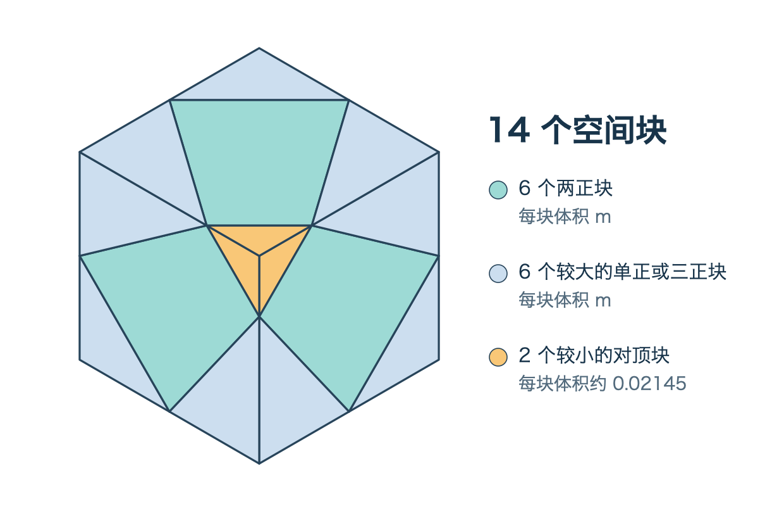
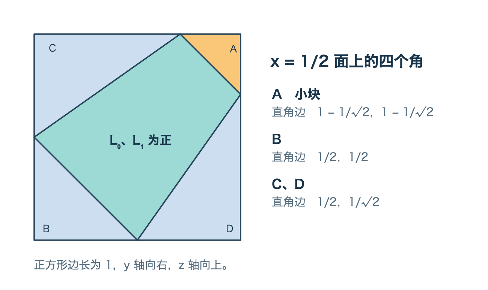

# 四个平面切一个立方体，怎样让最大的一块最小？

把一个体积为 1 的立方体交给你。你可以任选四个平面，每一刀都贯穿整个立方体，切开的块保持原位。前三刀最多切出 8 块。第四个平面上，前三刀留下的三条直线最多把它分成 7 片，所以四刀最多切出 15 块。于是最大的一块至少占 $1/15$。最好的切法能离这个平均数多近？

答案约为 **7.97589%**。取得它的切法只有一种，允许把立方体转动、镜像，或把四刀换个次序。尤其有趣的是，最优解只切出 **14 块**。其中 12 块一样大，另外两块各占约 2.145%。

## 先切出这 14 块

把立方体写成 $[-1/2,1/2]^3$。第一刀垂直于体对角线 $(1,1,1)$，通过中心。其余三刀从同一个方程轮换坐标得到。依次把四个等号左边记作 $L_0,L_1,L_2,L_3$。

$$
\begin{aligned}
L_0&=x+y+z, &L_1&=\sqrt2\,x-y-z,\\
L_2&=-x+\sqrt2\,y-z, &L_3&=-x-y+\sqrt2\,z .
\end{aligned}
$$

每块可以用四个正负号命名。例如 $++--$ 表示前两式为正、后两式为负。因为 $(2-\sqrt2)L_0+L_1+L_2+L_3=0$，全正和全负都不会出现。四刀过中心，所以每块都是从中心向立方体表面张开的锥体。只要知道它在六个面上占了多大面积，就能算出体积。

先算 $++--$。由 $L_1-L_2\ge0$ 和 $L_1-L_3\ge0$ 得 $x\ge y,z$。再由 $\sqrt2 L_0-L_2\ge0$ 和 $\sqrt2 L_0-L_3\ge0$ 得 $x\ge-z,-y$。因此它的底面全在 $x=1/2$ 上。把这一面放平，四条切线恰好从单位正方形的四角各切掉一个直角三角形。

图中的长度可以直接从方程读出。例如在右上角，切线 $L_1=0$ 给出 $y+z=1/\sqrt2$，两条直角边都是 $u=1-1/\sqrt2$。左下角两边都是 $1/2$，另两角的直角边分别为 $1/2$ 和 $1/\sqrt2$。扣去四个三角形，底面积为

$$
1-\frac{u^2}{2}-\frac18-2\cdot\frac{1}{4\sqrt2}
=\frac{1+2\sqrt2}{8}.
$$

锥高是 $1/2$，体积等于底面积的六分之一。换坐标、作中心反射，六种有两个正号的块都能化成这一块，体积都是

$$
m=\frac{1+2\sqrt2}{48}.
$$

右上角还给出了小块的体积。只有 $L_0$ 为正时，令 $S=x+y+z>0$，其余三个不等式分别给出 $x,y,z<S/(1+\sqrt2)$。任取两项相加都小于 $S$，所以第三项为正。这个块只碰到三个正坐标面，在每个面上各占图中右上角那个小三角形。它和对面那块的体积分别都是 $s=3(u^2/2)/6=(3-2\sqrt2)/8$。剩余六种符号通过坐标置换与中心反射彼此等价，由总体积算出每块占 $(1-6m-2s)/6=m$。这就算完了上界，连同每块的体积。

这也解释了怎么猜到 $\sqrt2$。先把后三刀中的 $\sqrt2$ 换成 $1<t<2$。同一张图里，右上角的两条边变成 $1-t/2$，另两角较长的边变成 $t/2$。于是每个两正块的体积为 $a(t)=(3+2t-t^2)/48$，每个小块的体积为 $s(t)=(1-t/2)^2/4$。若想让另外六块也恰好与两正块一样大，总体积要求 $12a(t)+2s(t)=1$。约去一次项，恰好得到 $t^2=2$。这给出了候选方向。真正费力的是证明所有四刀都得服从同一个下界。

## 为什么四刀任意倾斜、平移，也不会更好？

要证下界，可以假想一组有希望打平此纪录的切法，跟踪它在八个顶点上留下的符号。先讨论一般位置，暂时避开平面经过顶点或四刀共点等情形。取一个略宽的有理数门槛 $q=0.079759$，假设最大块体积 $M\le q$。

看其中任意一刀。它的一侧最多容纳其余三刀切出的八个块，所以另一侧至少占 $1-8q>1/6$。两侧都有正体积，因而都含立方体顶点。如果较小的顶点集合只含一个角，沿该角引出的三条棱所截的长度都至多为 1，截下的四面体体积至多为 $1/6$。这就排除了单顶点侧。把各坐标轴朝向选好后，半空间在顶点上向下封闭，逐个加入顶点，数量较少的一侧只有下图四种形状。

它们一共给出 $12+24+3+4=43$ 种无向分法。取四刀，允许同一种分法出现多次，再用立方体的 48 个对称合并等价情形，得到 **3,746 类**。每一类内部仍有连续无穷多种切法。

这个数还可以靠几何减少。举个例子，若两刀分别截下顶面上两条相邻的棱，取这两刀的另一侧。它们都含底面的四个角，还共同含着顶面上没被截去的那个角。两个半空间的交于是包含一座底面积为 1、高为 1 的四棱锥，体积为 $1/3$。剩下两刀至多把它分成四块，必有一块至少占 $1/12>q$。另一个归约考察任意三刀。若至多形成六块，第四刀后最大块仍至少占 $1/12$。若形成七块，三刀证书给出最大块严格大于 $4/25$，第四刀后仍大于 $2/25>q$。所以每组三刀都必须实现八个符号，交点落在立方体内部。

用同块顶点的凸包、重复的角星等限制筛完，留下 1,737 类。表中的“棱”指图中第一种顶点分法。

| 剩余类型 | 类数 | 整个类型上的结论 |
| --- | ---: | --- |
| 恰有两把棱切刀 | 206 | $M>q$ |
| 恰有一把棱切刀 | 774 | $M>q$ |
| 无棱切刀，其余非交替类型 | 756 | $M>q$ |
| 四个不同角星 | 1 | 含等号，需要再分方向 |

## 怎样证明一整类连续的切法？

一次排除的单位是一个参数盒。例如，用平面在几条棱上的截高作坐标，各给它们一个范围。对盒内所有切法，取某个符号块共同包含的半空间交，从它的投影面积算出体积下界。如果下界已经大于 $q$，盒子就结束了。同一个块在整个盒子上未必都够大，这时可以合用几个块。假如一组非负权重满足 $\sum w_i V_i>q\sum w_i$，至少有一个 $V_i>q$。程序可以试选权重，接受时用整数或向外舍入的区间重验不等式。

界还不够紧，就沿一个参数把盒子分成相接的两个闭盒，继续同样的论证。还可以用已证必要条件收紧区间。这样，一棵每个叶子都有结论的有限树，就证明了整个根盒。即使坏切法只占极窄的范围，也必须落入某个叶子。全局证明的计算量主要花在这些树上。

最后一类的参数最值得看。把一个正四面体的四个立方体顶点记作 $v_0,\ldots,v_3$，给刀编号定向，使刀 $i$ 在 $v_i$ 一侧取正。在边长为 2 的坐标中，第 $i$ 行的三个分数 $C_{ij}=-n_i\cdot v_j$（$j\ne i$）均大于该刀偏移的绝对值。每行除以其中一个最大分数，方向就只剩两个自由数，四行共八个，另有四个独立偏移。

若第 $i$ 行选中第 $j$ 列，就画一支箭头 $i\to j$。四支箭头共 $3^4=81$ 种选法，重排四个标签后只剩六种。用四个数字依次写下箭头的终点，例如 $1230$ 就是四个标签首尾相接。两对互选的 $1032$ 和四循环 $1230$ 都能在全域证出 $M>q$。其余四种为 $1000,1001,1002,1200$。最大分数相等时，任取其中一个都在覆盖内。

等号附近需要另一种论证。离开候选点任意小的距离，最大块体积也可以任意接近 $m$。这里选取十二个大块体积的正权重，把它们高于 $m$ 的加权量记作 $F$。先让四刀过中心。在候选方向，$F$ 和一阶导数都为零。对八个方向坐标的每组正负号各作一次二阶下估，用整数行列式检验得到 **256 个正定二次型**。因此在指定坐标半径 $1/35$ 内，只要方向改变，$F$ 就严格变正。再允许平移，把每对原先对顶的块写成体积 $a,b$，用 $2\max(a,b)=a+b+|a-b|$ 保留平移造成的不平衡。偏移证书证明，在候选阈值允许的范围内，任何非零平移都会使这组加权比较严格增加。于是局部也只有候选点取等号。

局部邻域外的覆盖使用有理门槛 $q_*=\lceil 2^{40}m\rceil/2^{40}$，有 $m<q_*<q$。一般位置的切法只要满足 $M\le q_*$，方向一定已进入上述闭邻域的某个对称像。

## 最优解恰好四刀共点，怎么把它算回来？

让一般位置的切法趋近任意一组给定平面。除了极限平面上的点，每个点最后都会稳定地落在同一个符号块里。四个平面本身体积为零，所以 16 个符号块的体积都连续（空块算零），它们的最大值也连续。一般位置已经证明的 $M\ge m$ 随之传到所有切法。

等号还要多走一步。如果极限切法满足 $M=m$，由于 $m<q_*$，充分靠后的近似切法都满足 $M<q_*$。它们的方向都在上面的局部闭邻域及其有限个对称像里，极限也在其中。对极限方向和它的实际偏移应用局部定理，四刀必须回到开头的构型。

所以最小的最大块体积恰为 $(1+2\sqrt2)/48$，所有最优切法都与图一等价。构造及体积可以手算。全局下界中的七块估计、连续参数覆盖和局部二阶比较使用计算机辅助证明。详细推导、逐类记录和复算命令预计发布在 GitHub 仓库 [ky-reflection/cube-four-planes-proof](https://github.com/ky-reflection/cube-four-planes-proof)。
